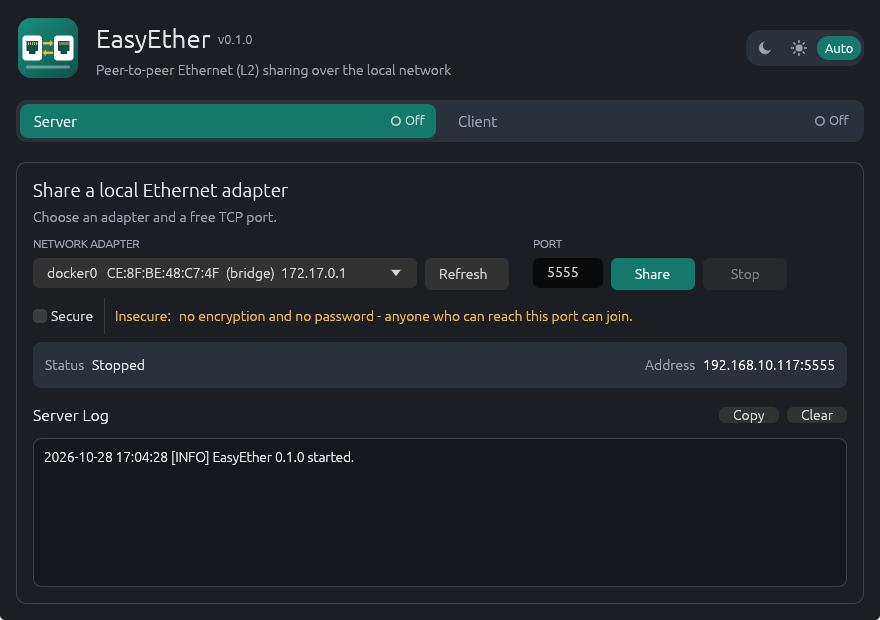
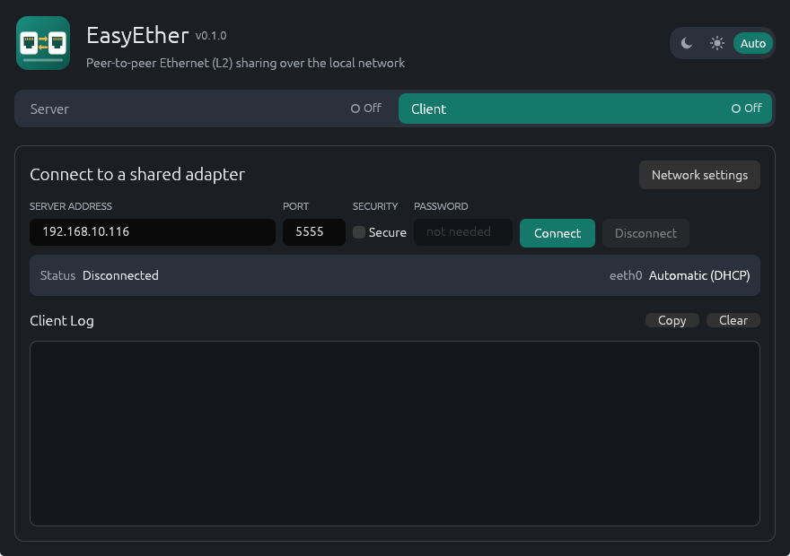

# EasyEther

**Share an Ethernet port with another computer over the network, at layer 2.**

[](https://github.com/galibozek/easyether/actions/workflows/build.yml)
[](LICENSE)


The **Server** shares a physical network adapter, for example the one plugged into a car's
diagnostic (DoIP) port. The **Client** gets a virtual network adapter that behaves as if it
were plugged into the same switch. Raw Ethernet frames are carried end to end, so DoIP, UDS
over IP, ARP, DHCP, link-local addressing and any other protocol that works on the cable also
works through the tunnel, with the original diagnostic software, unchanged.

Typical use: a car in the workshop, a diagnostic laptop at home or in another branch.

| Server: share an adapter | Client: connect to it |
|---|---|
|  |  |

## Features

- **Layer 2 tunnel**: the client is "on the same cable" as the shared port. No routing, no NAT,
  no per-protocol configuration.
- **Secure by default**: TLS 1.3 plus an 8-character one-time password (`0-9a-z`) checked with
  SPAKE2 and bound to the server certificate. The password never travels over the network, cannot
  be brute-forced offline, and a man-in-the-middle is detected. Wrong passwords are rate limited
  per IP. An *insecure* plain-TCP mode exists for trusted LANs.
- **Resilient**: keepalives, dead-link detection in 15 s, automatic reconnection with back-off,
  the virtual adapter stays up across reconnects, a live session can never be taken over by
  another client, and an adapter that disappears (USB re-plug) is reopened automatically.
- **Live status**: throughput per direction on the tabs, detailed log with copy/clear.
- **IPv4 and IPv6**: the server listens on both; the client accepts host names and IPv4/IPv6
  literals, including link-local with a zone (`fe80::1%eth0`, `fe80::1%12`).
- **Desktop app**: Windows x64/x86 and Linux, light/dark theme, system tray (closing the window
  keeps the tunnel running), confirmations before anything disruptive, optional static IPv4 on
  the client adapter, and a command-line mode for headless use.
- **No kernel code of our own**: Windows uses SoftEther VPN's signed `SeLow`/`Neo6` drivers
  (bundled, unmodified); Linux uses `AF_PACKET`/TAP and asks for privileges through polkit only
  when needed.

## Download

Prebuilt packages are attached to each [release](https://github.com/galibozek/easyether/releases):

| Package | Contents |
|---|---|
| `EasyEther-<version>-windows-x64.zip` | `easyether.exe` (64-bit) + drivers |
| `EasyEther-<version>-windows-x86.zip` | `easyether.exe` (32-bit) + drivers |
| `EasyEther-<version>-linux-x64.tar.gz` | `easyether` |

The Windows executable is not code-signed yet; SmartScreen may ask for confirmation on first
start. The drivers it installs are signed by the SoftEther project.

## Quick start

**Sharing computer (Server)**

1. Windows: unzip, start `easyether.exe` (it asks for administrator rights) and accept the driver
   installation when prompted. Linux: start `easyether`; a polkit password dialog appears when you
   share or connect.
2. On the **Server** tab pick the network adapter that is plugged into the device (car) and click
   **Share**.
3. Tell the other side your address, the port (default `5555`) and the password shown.
   If the client is outside your network, forward the TCP port or use a VPN; the address to give
   is then the one the client can reach.

**Diagnostic computer (Client)**

1. Start EasyEther, open the **Client** tab, enter address, port and password, click **Connect**.
2. The virtual adapter ("VPN Client Adapter - VPN127" on Windows, `eeth0` on Linux) now sits on
   the remote network. Use DHCP, link-local, or set a static IPv4 under **Network settings**.
3. Start the diagnostic software and select that adapter, as if the cable were plugged in locally.

Closing the window hides EasyEther in the system tray; **Exit** is in the tray menu.

## How it works

```
 car ── Ethernet ── [Server: physical NIC] ══ TCP (TLS 1.3) ══ [Client: virtual NIC] ── diagnostic software
                    SeLow / AF_PACKET / bridge port              Neo6 / TAP
```

| | Windows | Linux |
|---|---|---|
| Server, physical adapter | SoftEther `SeLow` NDIS protocol driver (promiscuous capture + injection) | `AF_PACKET` raw socket, promiscuous, GRO/LRO off for the session |
| Server, Linux bridge (`docker0`, `br0`, `virbr0`) | – | TAP port `eeths0` added to the bridge; the host itself is reachable too |
| Client virtual adapter | SoftEther `Neo6`, instance `VPN127` | TAP `eeth0` |
| Privileges | runs as administrator (manifest) | normal user; root helper via `pkexec` passes descriptors over a Unix socket |

Frames are batched (up to 256 per message) over one TCP connection with `TCP_NODELAY`, keepalives
every 2 s and a 15 s dead-link timeout (also enforced with `TCP_USER_TIMEOUT` / `TCP_MAXRT`).
After a loss the client reconnects (0, 1, 2, 5, 10 s back-off); a client that was intentionally
disconnected (server pressed Stop or generated a new password) is told so and does not retry.

**Limitation (by design, same as SoftEther's local bridge):** through a physical adapter the
sharing computer *itself* is not reachable from the client, only the devices behind the cable
are. On Linux, sharing a bridge interface lifts this limitation.

### Security model

- Each *Share* generates a fresh self-signed certificate and a random 8-character password.
- Client and server run SPAKE2 on the password; the resulting key confirms both sides and is
  bound to the server certificate's fingerprint. An attacker who relays the TLS connection has a
  different certificate and fails the confirmation; captured traffic allows no offline guessing.
- Server-side limits: 10 s handshake deadline, at most 8 concurrent handshakes (2 per IP),
  10-minute block after 5 wrong passwords from one IP, rate-limited logging of probes.
- A connected client is never displaced by a newcomer who knows the password; only a session whose
  peer has been silent for the dead-link timeout can be replaced.
- *Insecure* mode (both sides must enable it) sends plain TCP: anyone who can reach the port can
  join the shared network. Use it only on trusted LANs.

## Command line

```
easyether --cli list
easyether --cli server <adapter> [port] [--insecure]
easyether --cli client <host> [port] --password <8 chars> [--ip <addr>/<prefix>] [--insecure]
easyether --install-drivers | --uninstall-drivers          # Windows (also drivers\*.bat)
```

`EASYETHER_PASSWORD` sets the server password instead of generating one. Ctrl-C stops gracefully.

## Building from source

Requires a stable Rust toolchain ([rustup](https://rustup.rs)).

```sh
cargo build --release          # Linux binary: target/release/easyether
cargo test
cargo clippy --all-targets
```

Windows packages are cross-compiled from Linux (or built natively in Git Bash):

```sh
sudo pacman -S mingw-w64-gcc   # Debian/Ubuntu: apt install mingw-w64
rustup target add x86_64-pc-windows-gnu i686-pc-windows-gnu
./package-windows.sh x64       # dist/EasyEther-<version>-windows-x64.zip
./package-windows.sh x86
```

`.github/workflows/ci.yml` checks pull requests (fmt, clippy, tests); `.github/workflows/build.yml`
builds the three packages when a GitHub release is published and attaches them to it.

### Repository layout

```
src/main.rs        entry point, CLI
src/tunnel.rs      server/client workers, sessions, reconnect, abuse limits
src/secure.rs      TLS + SPAKE2 handshake, SecureStream
src/proto.rs       wire protocol (hello, frame batches, Close)
src/l2/            adapters: linux/ (AF_PACKET, TAP, pkexec helper), windows/ (SeLow, Neo6, install)
src/gui/           egui front-end, tray
drivers/           SoftEther SeLow/Neo6 driver packages (x64, x86) + install/uninstall .bat
```

## Troubleshooting

- **Client cannot connect**: check the port is open on the server (Windows: EasyEther adds a
  firewall rule automatically), that *Secure* is set the same way on both sides, and that the
  address is one the client can reach (public address or VPN when remote).
- **Connected, but the device does not answer**: the device must be on the shared adapter's
  cable; the sharing computer itself does not answer through a physical adapter (see above).
  Give the client adapter an address in the device's subnet or use link-local.
- **"Drivers missing" on Windows**: click *Install drivers* (administrator rights required);
  a restart may be needed once. `drivers\uninstall-drivers.bat` removes them.
- **Linux, no polkit dialog / "pkexec not found"**: install polkit, or grant the binary
  capabilities once: `sudo setcap cap_net_admin,cap_net_raw+ep <path to easyether>`.
- **Window does not hide to the tray on Linux**: the tray needs a StatusNotifier host (KDE, or
  GNOME with the AppIndicator extension) and the user's session D-Bus; do not run with `sudo`.

## Contributing

Issues and pull requests are welcome. Please run `cargo test` and `cargo clippy --all-targets`
before submitting. By contributing you agree that your contribution is licensed under the
project license below.

## License

EasyEther is free software under the **GNU General Public License v3.0 or later** (see
[`LICENSE`](LICENSE)); improvements must stay open under the same terms.

The bundled SoftEther VPN `SeLow` and `Neo6` drivers are unmodified, signed binaries from
[SoftEtherVPN_Stable](https://github.com/SoftEtherVPN/SoftEtherVPN_Stable)
(`src/bin/hamcore/DriverPackages`), Copyright (c) SoftEther VPN Project, licensed under the
Apache License 2.0 ([`drivers/LICENSE-SoftEther.txt`](drivers/LICENSE-SoftEther.txt), see
[`NOTICE`](NOTICE)).

Main libraries: [egui/eframe](https://github.com/emilk/egui), [rustls](https://github.com/rustls/rustls),
[rcgen](https://github.com/rustls/rcgen), [spake2](https://github.com/RustCrypto/PAKEs),
[socket2](https://github.com/rust-lang/socket2), [tray-icon](https://github.com/tauri-apps/tray-icon),
[ksni](https://github.com/iovxw/ksni), [windows-sys](https://github.com/microsoft/windows-rs),
[resvg](https://github.com/linebender/resvg) (build-time logo rendering).
